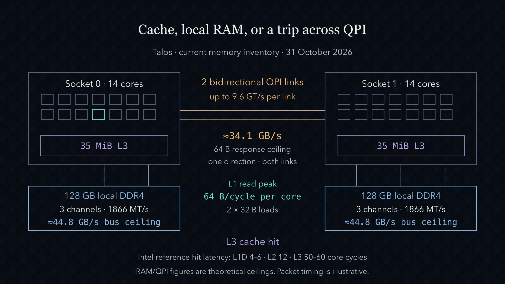
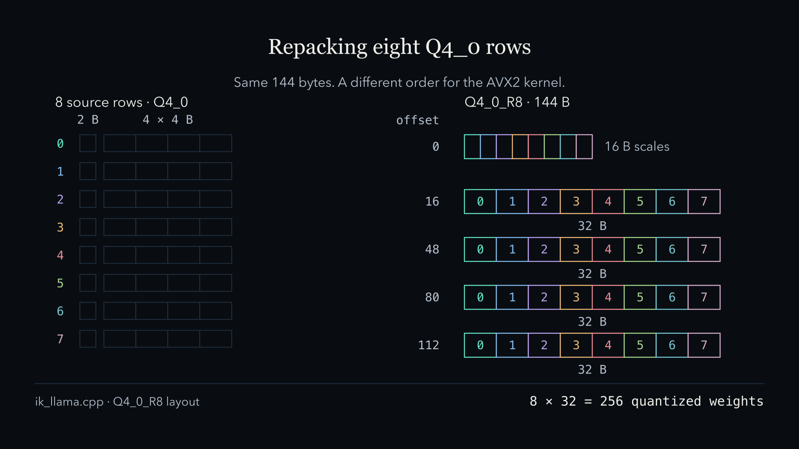
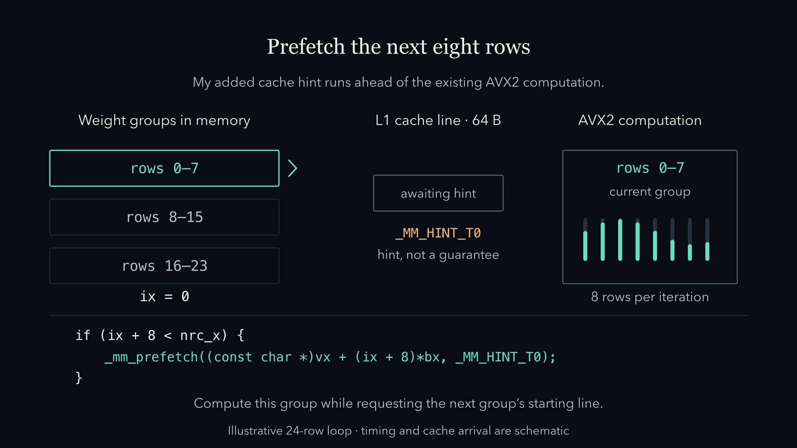
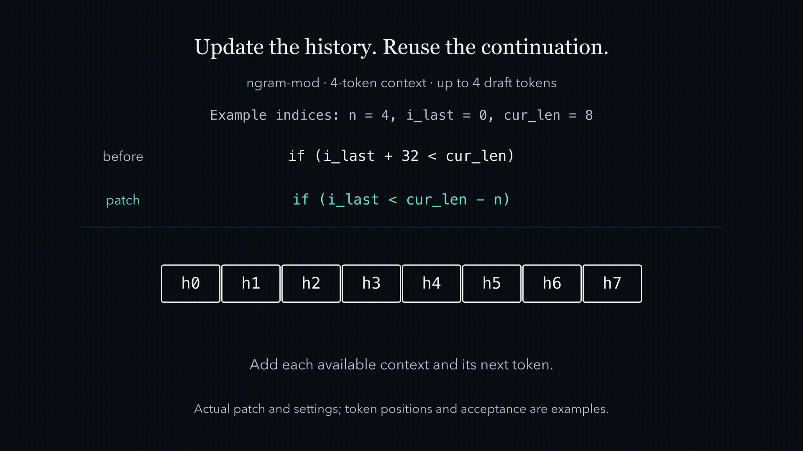
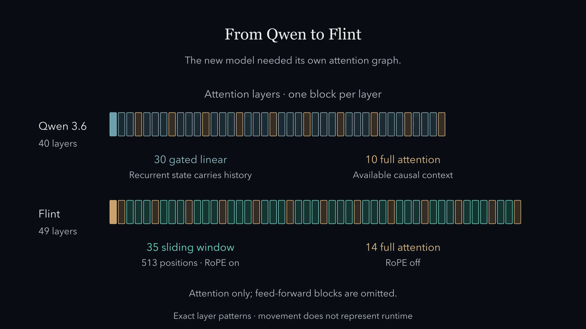

# A coding assistant on two 2016 Xeons

I wanted a local coding assistant on Talos, my Dell PowerEdge T630. It has two Xeon E5-2680 v4 CPUs, 28 physical cores, and 256 GB of DDR4. Plenty of room to load a model (in theory). Getting responses back quickly took a lil more work.

TLDR: I spent months tuning Qwen3.6-35B-A3B: thread counts, memory placement, quantization, speculative decoding, and changes to the C++ engine. Then I just switched for to a newer model, Flint, and got better coding answers at almost the same speed.

## Dual Socket Setup

Talos has AVX2, but no AVX-512, VNNI, or AMX. Each socket has its own 35 MiB L3 and local RAM. A core can read RAM attached to either CPU but a read from the other socket crosses QPI, the link between them. Using both sockets gives the model more cores and memory channels, but the threads and pages still need somewhat sensible placement.



The current DIMM inventory reports **1866 MT/s across three populated channels per socket**, giving a raw bus ceiling of about **44.8 GB/s per socket**. The CPU's advertised DDR4-2400 maximum assumes four channels. 

The first thing I did was compare keeping work and memory on one socket with using both. In the early Qwen runs, mean decode rose from [11.16 tokens/s on one socket](archive/notebook-v1/gpqa_reports/gpqa_exp0_single_numa_baseline_50q_report.md) to [15.72 tokens/s with both sockets](archive/notebook-v1/gpqa_reports/gpqa_exp4_numa_interleave_pure_decode_50q_report.md), about 41% faster. Engine and thread settings also changed between those runs.

The later [dual-socket configuration](https://github.com/James-Begin/Homelab-inference/blob/e72afab125d7bb5bf844e1c2d23ff3a204ba1727/logs/runs/code_exp50_phys_pinning_28threads_repacked_iq4xs_muge_suffix_q4kv/manifest.json) uses one logical CPU per physical core and interleaves memory pages across both nodes.

## Repacking Weights

I tested Q4_0_R8, an upstream ik_llama.cpp format that arranges weights for processing eight matrix rows together. Instead of storing each row separately, it places matching chunks from all eight rows side by side.

Each group is 32 bytes wide, matching an AVX2 register. The kernel can load those chunks together, with less rearranging during inference.

The weights keep the same values and occupy the same space: **256 weights in 144 bytes**. Only their order changes.

My [early Qwen sweep notes](archive/docs/writeup.md#run-time-tensor-repacking) recorded roughly a **6.75% improvement in the combined prompt-processing and generation benchmark** with runtime repacking enabled.

<details>
<summary>See the upstream eight-row layout</summary>

The layout starts with eight two-byte scales, followed by four 32-byte groups. Each group takes four packed bytes from each source row. The upstream [repack function](https://github.com/ikawrakow/ik_llama.cpp/blob/87fc8701ff4da81a7d2a91ec0695f95eb3066a47/ggml/src/iqk/iqk_quantize.cpp) rearranges the values, and the [AVX2 kernel](https://github.com/ikawrakow/ik_llama.cpp/blob/87fc8701ff4da81a7d2a91ec0695f95eb3066a47/ggml/src/iqk/iqk_gemm_legacy_quants.cpp) reads them in four 32-byte loads.

[](docs/media/repack-eight-rows.gif)

Repacking preserves the 144-byte total. Row colors track the source rows. Select the image to watch the GIF, or open the [MP4](docs/media/repack-eight-rows.mp4).

</details>

## Prefetching Weights

The kernel processes eight rows at a time, so it knows which group comes next. In my [local AVX2 patch](https://github.com/James-Begin/Homelab-inference/blob/e72afab125d7bb5bf844e1c2d23ff3a204ba1727/patches/0002-avx2-64byte-alignment-and-repacking.patch), I added a prefetch hint to request the next group's starting cache line while the CPU works on the current group.



```diff
         for (int ix = 0; ix < nrc_x; ix += 8) {
+            if (ix + 8 < nrc_x) {
+                _mm_prefetch((const char *)vx + (ix + 8)*bx, _MM_HINT_T0);
+            }
             const block_iq4_nl_r8 * iq4 = (const block_iq4_nl_r8 *)((const char *)vx + ix*bx);
             auto acc1 = _mm256_setzero_ps();
             auto acc2 = _mm256_setzero_ps();
```

`ix` marks the current group's first row; `ix + 8` marks the next one. The bounds check skips the hint when there are no more groups.

The hint requests the cache line containing the next group's starting address. Getting that request started early may reduce waiting later, although the data's arrival time isn't guaranteed.

## Keeping counters on separate cache lines

The same patch separates shared barrier counters onto cache-line boundaries:

```cpp
__attribute__((aligned(CACHE_LINE_SIZE))) atomic_int n_barrier;
__attribute__((aligned(CACHE_LINE_SIZE))) atomic_int n_barrier_passed;
```

When cores update different variables on the same cache line, their writes can invalidate each other's cached copies. This is called false sharing. Giving these counters separate 64-byte boundaries keeps them from sharing a line, although threads still have to coordinate on each counter.

## Speculative Decoding/MTP

I tried speculative decoding to get more tokens out of each expensive verification step. A cheaper mechanism (like a draft model) proposes the next few tokens and the main model checks it and keeps an accepted prefix. Bad guesses add more work, so balancing the draft acceptance rate with the number of drafted tokens is key.

The Qwen experiments included MTP, which uses a built in auxiliary prediction head. Flint doesn't have this so instead I used a custom n-gram speculator instead. These are the relevant settings from its [manifest](https://github.com/James-Begin/Homelab-inference/blob/e72afab125d7bb5bf844e1c2d23ff3a204ba1727/logs/runs/code_exp94_flint_ik_llama_muge_repacked_ngram_mod_slot050_decoupled26_ceiling4096_q4kv/manifest.json):

```text
--spec-type ngram-mod:n_max=4,ngram_size_n=4
```

It looks up a four-token context and proposes up to four continuation tokens for verification. One [local change](https://github.com/James-Begin/Homelab-inference/blob/e72afab125d7bb5bf844e1c2d23ff3a204ba1727/patches/0004-speculative-decoding-enhancements.patch) updates the history table as new n-grams become available, replacing the old chunk guard:



```diff
- if (i_last + 32 < cur_len) {
+ if (i_last < cur_len - n) {
```

Speculation can also produce some misleadingly good numbers. [Experiment 42](https://github.com/James-Begin/Homelab-inference/blob/e72afab125d7bb5bf844e1c2d23ff3a204ba1727/logs/raw_checkpoints/exp42_phys_pinning_28threads_suffix_pmin015_burst16_q4kv_checkpoint.json) includes a roughly 66-token/s result whose output falls into repeated punctuation and produces a garbage answer, essentially I had just built super fast punctuation.

There were less entertaining failures in the serving path. Malformed UTF-8 could make JSON serialization throw errors after generation. [Patch 0006](https://github.com/James-Begin/Homelab-inference/blob/e72afab125d7bb5bf844e1c2d23ff3a204ba1727/patches/0006-fix-server-safe-json-to-str-utf8-truncation.patch) switches from `data.dump()` to `safe_json_to_str(data)`, which substitutes replacement characters for malformed bytes. I also patched a [parser exception path](https://github.com/James-Begin/Homelab-inference/blob/e72afab125d7bb5bf844e1c2d23ff3a204ba1727/patches/0005-catch-server-peg-parser-exception.patch).

## Porting Flint to ik_llama

Trying Flint meant implementing its architecture in this engine build: metadata and tensor loading, vocabulary handling, and the computation graph. Qwen uses gated linear attention in 30 of its 40 layers and full attention in the other 10. Flint uses a 513-position sliding window in 35 of its 49 layers, with full attention in the other 14.

Flint's sliding layers apply rotary position embeddings (RoPE) but its full-attention layers skip them. The graph has to select both the attention mask and the RoPE setting for each layer:



These lines from the [port](https://github.com/James-Begin/Homelab-inference/blob/e72afab125d7bb5bf844e1c2d23ff3a204ba1727/patches/0003-flint-40b-moe-architecture-port.patch) illustrate some of this:

```cpp
const bool is_swa = hparams.swa_layers[il];
const bool do_rope = hparams.has_rope(il);
auto KQ_mask_l = is_swa ? KQ_mask_swa : KQ_mask;
```

The port let me run Flint with the upstream repacked kernels and merged up/gate path. I could then evaluate it with the same experiment tooling used for Qwen.

## In the end, time is a valuable thing

These are the saved [Qwen exp50](https://github.com/James-Begin/Homelab-inference/tree/e72afab125d7bb5bf844e1c2d23ff3a204ba1727/logs/runs/code_exp50_phys_pinning_28threads_repacked_iq4xs_muge_suffix_q4kv) and [Flint exp94](https://github.com/James-Begin/Homelab-inference/tree/e72afab125d7bb5bf844e1c2d23ff3a204ba1727/logs/runs/code_exp94_flint_ik_llama_muge_repacked_ngram_mod_slot050_decoupled26_ceiling4096_q4kv) coding runs, each covering 164 tasks:

| Metric | Qwen3.6-35B-A3B | Flint 40B |
| --- | ---: | ---: |
| Mean decode rate | 21.31 tokens/s | 20.77 tokens/s |
| Mean elapsed time per task | 194.41 s | 109.48 s |
| Tasks passing both HumanEval base and extra tests | 106/164 | 148/164 |

Elapsed time includes failed tasks. Ultimately, Flint runs slightly slower, but its significant gains in "intelligence" helps solve problems faster, leading to essentially faster and smarter problem solving!

## Code and records

- [Setup and regression checks](docs/reproduction.md), including the [build script](scripts/build_engine.sh)
- [Engine and server patches](patches/README.md), including [native corrections added after these runs](patches/0007-fix-buffer-capacity-and-moe-partitioning.patch)
- [Benchmark scripts](benchmarks/) and [saved experiment records](logs/runs/)
- [Results and measurement limits](RESULTS.md)
- [Historical experiments](archive/README.md)
- [Animation source and render instructions](animations/README.md)
