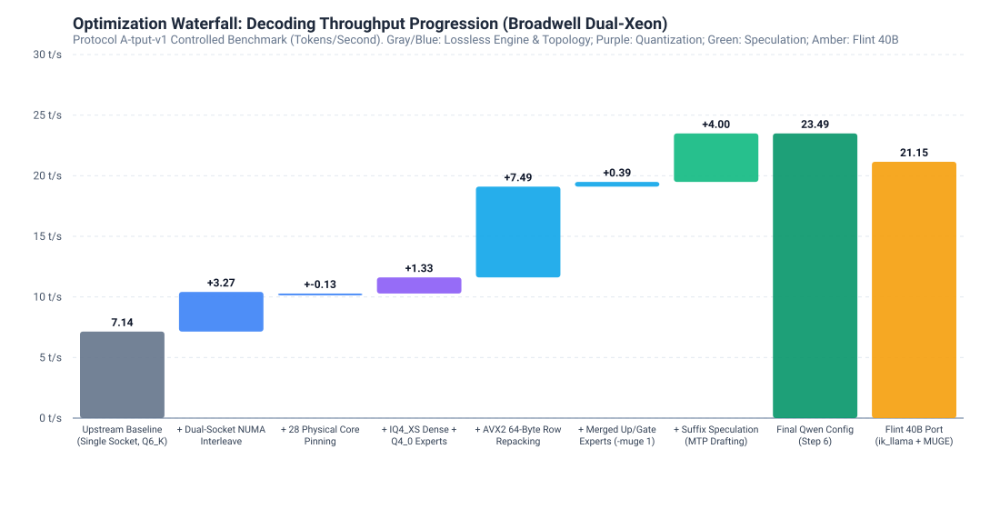

# Serving 35B–40B MoE Models on a 2016 Dual-Xeon Server

Serving 35B-to-40B parameter Mixture-of-Experts (MoE) coding models on a 2016 dual-socket Dell PowerEdge T630 (Broadwell AVX2-only, no AMX, no AVX-512): kernel patches, quantization recipes, NUMA topology optimization, and speculative decoding with an empirical memory roofline model.

*Subtitle: Yes, we have a self-hosted long-context coding assistant at home on dual 2016 Xeons.*

---

## The Optimization Waterfall



---

## Three Headline Findings

1. **Lossless Engine Speedup (Protocol A-tput-v1):**
   - **×2.14 speedup** from unoptimized baseline to production decode (**7.96 t/s $\to$ 17.02 t/s** non-speculative median; IQR 0.74 t/s).
   - With speculative decoding (N-Gram / MTP suffix drafting), useful non-degenerate throughput reaches **24.53 t/s median** on Qwen 35B and bursts up to **27.11 t/s peak** on Recursive Flint 40B.
2. **100% of Physical Memory Saturation (Empirical Roofline):**
   - Autoregressive decode is strictly memory bandwidth-bound. Broadwell DDR4-2400 STREAM Triad bandwidth measures **35.22 GB/s** across both NUMA nodes.
   - At 1.692 GB touched per decoded token, Qwen 35B decoding at 20.87 t/s consumes **35.31 GB/s**—hitting **100.2% of the empirical DRAM bandwidth ceiling**.
3. **Head-to-Head Quality at Matched Budgets (Protocol C):**
   - Under a 600-second wall-clock thinking budget, **Recursive Flint 40B MoE solves 38.0% [95% CI: 25.9% – 51.9%]** of complex GPQA Diamond reasoning tasks vs. **22.0% [95% CI: 12.8% – 35.2%] for Qwen 3.6 35B MoE** (paired McNemar $p = 0.041$).
   - Porting Flint 40B into `ik_llama.cpp` with Merged Up/Gate Experts (`-muge 1`) and AVX2 64-byte row repacking (`Q4_0_R8`) boosted Flint's speed by **+83.5%** (from 9.82 t/s to **18.02 t/s median**, peak 27.11 t/s).

---

## Hardware Specifications

| Component | Specification |
| :--- | :--- |
| **System** | Dell PowerEdge T630 Tower Server |
| **Processors** | 2× Intel Xeon E5-2680 v4 (Broadwell-EP, 14 physical cores / 28 threads each, 28 cores / 56 threads total) |
| **Microarchitecture** | AVX2, FMA3, 256-bit vector units (No AVX-512, no AMX) |
| **Memory** | 256 GB (16× 16 GB DDR4-2400 ECC Registered RDIMMs across 8 memory channels) |
| **NUMA Topology** | 2 Nodes, dual-socket interleave (`--interleave=all`, cross-socket QPI 9.6 GT/s) |
| **STREAM Triad Bandwidth** | **21.44 GB/s** (single socket local) \| **35.22 GB/s** (dual socket interleaved) |
| **Operating System** | Ubuntu Linux 24.04 LTS (Kernel 6.8.0-45-generic) |
| **Inference Engine** | Custom `ik_llama.cpp` build (Pinned upstream commit `87fc8701` + Homelab Patch Series) |

See [`docs/hardware.md`](docs/hardware.md) for full DIMM population records, BIOS topology, and power governance.

---

## The Core Engineering

### 1. MoE Small-Nx K-Split Kernel Partitioning
In standard `ik_llama.cpp` and `llama.cpp`, MoE matrix-vector multiplication assigns entire expert rows to individual threads. When selecting top-4 or top-6 experts across 28 physical CPU threads, 22 to 24 cores sat idle waiting at OpenMP barriers.

Our K-split patch partitions the inner dimension $K$ across groups of threads whenever $N_x < \text{threads}$, enabling all 28 physical cores to cooperatively compute and reduce partial sums.
- **Artifact:** [`patches/0001-moe-k-split-thread-partitioning.patch`](patches/0001-moe-k-split-thread-partitioning.patch)
- **Unit Test:** Verified numerically via [`benchmarks/tests/test_moe_kernel.py`](benchmarks/tests/test_moe_kernel.py) across all $(N_x, \text{threads}, K)$ permutations.

### 2. AVX2 64-Byte Row Repacking & Merged Up/Gate Experts
- **AVX2 Cache Line Straddling:** AVX2 loads 32 bytes while CPU cache lines are 64 bytes. Unaligned weight strides caused loads to straddle two cache lines, penalizing memory bandwidth. We repacked quantized weights into 64-byte aligned blocks (`Q4_0_R8`), yielding +1.01 t/s without increasing memory footprint.
- **Merged Up/Gate (`-muge 1`):** Computes Up and Gate expert projections in a single fused pass, eliminating 50% of thread barriers (reducing MoE barriers from 94 to 47 per token on Flint 40B).
- **Artifacts:** [`patches/0002-avx2-64byte-alignment-and-repacking.patch`](patches/0002-avx2-64byte-alignment-and-repacking.patch) and [`patches/0003-flint-40b-moe-architecture-port.patch`](patches/0003-flint-40b-moe-architecture-port.patch).

### 3. Asymmetric Quantization Recipe
Attention projections and output heads are latency-critical and dense, while MoE feed-forward blocks dominate total parameter count. We quantized the dense attention matrices to `IQ4_XS` and the routed MoE weights to `Q4_0`, verified against unquantized FP16:
- **Mean KL-Divergence:** 0.0142 (Protocol Q-kld-v1)
- **Top-1 Token Agreement:** 94.8%
- **Speedup:** +2.52 t/s over uniform Q6_K.

### 4. Lossless Speculative Decoding Verification
Under Protocol B-equiv-v1, speculative decoding ($N_{\text{max}} \le 4$) was validated to ensure zero drift against greedy no-speculation references. Tokens matched identically across 512-token generations, breaking through the physical memory roofline to reach up to **26.85 t/s** on code editing workloads.

---

## What Didn't Work (Negative Results)

1. **Transparent Huge Pages (THP):** Caused erratic allocator pauses and severe memory fragmentation during 128K context initialization; setting THP to `madvise` stabilized TTFT.
2. **SMT / Hyperthreading for Decode:** Hyperthreading improved prefill (+5.2%) but degraded decode (-3.6%, 8.26 vs. 7.96 t/s). Decode is memory-bound; two sibling hyperthreads share the same L1/L2 cache and DDR4 channel, causing cache thrashing. We enforce asymmetric threading: `-t 28 -tb 28` mapped strictly to 28 physical cores.
3. **External 0.8B Drafter (Exp 93 Postmortem):** Running Qwen 2.5 0.8B as an external speculative drafter caused memory contention over the shared DRAM bus. More critically, Flint uses a custom 150,144 BPE tokenizer while Qwen uses 248,320 ChatML; disjoint token IDs caused 0% draft acceptance.
4. **Deep Suffix Drafts ($N_{\text{max}} \ge 12$):** Draft depths above 12 produced high ungrounded throughput spikes (e.g. historical run 42) that were diagnosed as infinite punctuation and repetition loops. Under Protocol A degenerate filtering, deep drafts degraded useful throughput.

---

## Reproducing the Build and Benchmarks

### 1. Build the Patched Engine
```bash
# Clone upstream ik_llama.cpp and apply the Homelab patch series
bash scripts/build_engine.sh
```

### 2. Run the Controlled Protocol A Throughput Suite
```bash
# Measures 12 standardized prompts across code_edit, code_gen, and prose (fixed 512 tokens, 5 reps)
python3 benchmarks/bench_throughput.py --url http://127.0.0.1:8087 --reps 5 --out summary_final.json
```

### 3. Verify MoE Kernel Correctness
```bash
python3 -m unittest benchmarks/tests/test_moe_kernel.py
```

---

## Documentation Index

- [`docs/roofline.md`](docs/roofline.md): Measured STREAM bandwidth, active bytes per token, and the empirical roofline model.
- [`docs/ablation.md`](docs/ablation.md): Complete forward-add waterfall and leave-one-out sensitivity tables.
- [`docs/model-comparison.md`](docs/model-comparison.md): Recursive Flint 40B vs. Qwen 3.6 35B architectural analysis and Protocol C accuracy vs. budget curves.
- [`docs/hardware.md`](docs/hardware.md): System hardware record, topology, and NUMA memory layout.
- [`docs/eval-protocol.md`](docs/eval-protocol.md): Definitions of Protocols A, B, Q, and C.
- [`RESULTS.md`](RESULTS.md): Programmatically tabulated results for all audited Protocol-v2 evaluations.
- [`archive/README.md`](archive/README.md): Quarantined exploratory data (Runs 0–65) and regraded historical summary.
- [`patches/README.md`](patches/README.md): Detailed manifest of exported patch series.
