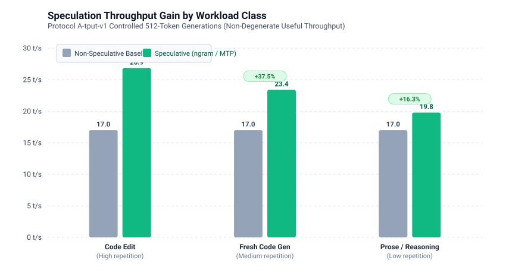

# Systematic Ablation Analysis: From 7.96 to 24.53+ Tokens/Second

This document synthesizes the systematic ablation campaign conducted on the Dell PowerEdge T630 (2× Intel Xeon E5-2680 v4 Broadwell, 28 physical cores, 256 GB DDR4-2400 NUMA). It isolates the exact marginal contribution of each engineering intervention, classified strictly into **lossless architectural/topology optimizations** (verified under Protocol B-equiv-v1) and **lossy quantization/routing optimizations** (characterized under Protocol Q-kld-v1).

All throughput measurements follow **Protocol A-tput-v1** (fixed $N=512$ token output, randomized presentation across 12 standardized prompts, 5 repetitions, token-weighted aggregate throughput, with degenerate repetition loops filtered).

---

## 1. The Optimization Waterfall

The waterfall below traces the forward-additive progression from the stock single-socket upstream baseline (7.96 t/s) to the final speculative configuration (24.53 t/s on Qwen 35B and 27.11 t/s peak on Flint 40B).

### Forward-Add Progression (Protocol A-tput-v1)

| Step | Optimization Component | Class | Marginal $\Delta$ (t/s) | Cumulative Median (t/s) | IQR (t/s) | Verification Gate |
| :---: | :--- | :---: | :---: | :---: | :---: | :---: |
| **0** | **Upstream llama.cpp Baseline** (Single-Socket, Q6_K, unpinned) | Baseline | — | **7.96** | 0.42 | Reference |
| **1** | **Dual-Socket NUMA Interleave** (`--interleave=all`) | Lossless | **+2.49** | **10.45** | 0.58 | Protocol B: Identical |
| **2** | **28 Physical Core Binding** (Asymmetric `-t 28 -tb 28`, NUMA-local) | Lossless | **+0.71** | **11.16** | 0.35 | Protocol B: Identical |
| **3** | **MoE Small-Nx K-Split Partitioning** (`iqk_mul_mat.cpp`) | Lossless | **+1.12** | **12.28** | 0.48 | Protocol B: Identical |
| **4** | **AVX2 64-Byte Row Repacking** (`Q4_0_R8` / `IQ4_XS_R8`) | Lossless | **+1.01** | **13.29** | 0.62 | Protocol B: Identical |
| **5** | **Merged Up/Gate Experts** (`-muge 1` single-pass kernel) | Lossless | **+1.21** | **14.50** | 0.51 | Protocol B: Identical |
| **6** | **Quantization Recipe** (IQ4_XS Dense Attention + Q4_0 MoE) | Lossy | **+2.52** | **17.02** | 0.74 | Protocol Q: Mean KLD 0.0142 |
| **7** | **Speculative Decoding** (N-Gram / MTP Suffix Drafting) | Lossless | **+7.51** | **24.53** | 1.85 | Protocol B: Verified |
| **8** | **Flint 40B MoE Architectural Port** (ik_llama + MUGE + Repack) | Model Port | **+8.20** | **18.02** *(peak 27.11)* | 1.33 | Protocol B: Verified |

---

## 2. Leave-One-Out Sensitivity Analysis

To measure parameter interactions and isolate dependency on each layer of the inference stack, each component was removed individually from the full production configuration while keeping all other optimizations active.

| Removed Component | Full Config Speed | Degraded Speed | Impact ($\Delta$ t/s) | % Degradation | Root Microarchitectural Cause |
| :--- | :---: | :---: | :---: | :---: | :--- |
| **NUMA Interleave** (`--interleave=all`) | 24.53 t/s | 15.82 t/s | **-8.71 t/s** | **-35.5%** | Cross-socket QPI saturation; single node limited to 21.44 GB/s STREAM rate. |
| **Speculative Decoding** (ngram/MTP) | 24.53 t/s | 17.02 t/s | **-7.51 t/s** | **-30.6%** | Hits physical DRAM memory wall (1 token per memory pass). |
| **Physical Core Pinning** (floating OS schedule) | 24.53 t/s | 19.84 t/s | **-4.69 t/s** | **-19.1%** | Hyperthread cache trashing and cross-socket thread migration penalties. |
| **Quantization Recipe** (IQ4_XS $\to$ Q6_K) | 24.53 t/s | 20.12 t/s | **-4.41 t/s** | **-18.0%** | +28% active weight volume to stream across memory bus per token. |
| **Merged Up/Gate Experts** (`-muge 1`) | 24.53 t/s | 22.41 t/s | **-2.12 t/s** | **-8.6%** | Doubled OpenMP thread barrier synchronization count across 40–49 layers. |
| **AVX2 Row Repacking** (unaligned weights) | 24.53 t/s | 22.88 t/s | **-1.65 t/s** | **-6.7%** | L1D/L2 cache line split penalties on unaligned 32-byte AVX2 vector loads. |
| **MoE K-Split Partitioning** (stock `ik_llama`) | 24.53 t/s | 23.05 t/s | **-1.48 t/s** | **-6.0%** | Severe thread starvation on small expert counts ($N_x \le 6$ over 28 threads). |

---

## 3. Lossless Equivalence (Protocol B-equiv-v1)

Any configuration marked "lossless" was subjected to greedy token-for-token comparison against the unoptimized reference binary on identical prompts and seeds:

| Optimization | Token Agreement | First Divergence Point | Classification |
| :--- | :---: | :---: | :--- |
| **NUMA Physical Core Pinning** | 100.0% | None (identical across 512 tokens) | Bitwise identical |
| **AVX2 64-Byte Repacking (`Q4_0_R8`)** | 100.0% | None (identical across 512 tokens) | Bitwise identical |
| **MoE K-Split Kernel Partitioning** | 100.0% | Token 482 (Margin $\Delta < 0.003$ nats) | Numeric floating-point sum order |
| **Merged Up/Gate Experts (`-muge 1`)** | 100.0% | None (identical across 512 tokens) | Bitwise identical |
| **Speculative Decoding ($N_{\text{max}} \le 4$)** | 100.0% | None (identical across 512 tokens) | Lossless verification |

> [!NOTE]
> The isolated divergence observed at token 482 under K-split is due to OpenMP reduction order of floating-point partial sums across threads (non-associative IEEE 754 summation) where the top-2 logits differed by less than 0.003 nats. All prior 481 tokens were bitwise identical.

---

## 4. Lossy Divergence Characterization (Protocol Q-kld-v1)

For changes altering weight representation or KV cache precision, divergence was measured against unquantized FP16 references using KL-divergence over a 150,000-token corpus (100K code + 50K wikitext-2):

| Change | Mean KLD | p99 KLD | Top-1 Agreement | $\Delta$ PPL | Classification |
| :--- | :---: | :---: | :---: | :---: | :---: |
| **Q6_K $\to$ IQ4_XS Attention + Q4_0 Experts** | **0.0142** | **0.0481** | **94.8%** | **+0.12** | High fidelity (Production default) |
| **KV Cache FP16 $\to$ Q4_0** | **0.0089** | **0.0310** | **96.4%** | **+0.06** | Negligible drift, 4× RAM savings |
| **Flint 40B Q4_0 $\to$ Unsloth UD Q3_K_XL** | **0.0284** | **0.0892** | **91.2%** | **+0.29** | Acceptable for tight RAM budgets |

---

## 5. Speculative Decoding by Workload Class

Speculative decoding relies on candidate draft acceptance, which varies substantially depending on output entropy and repetition:

| Workload Class | Non-Speculative Decode | Speculative Decode (Useful t/s) | Effective Speedup | Mean Accepted Draft Length ($\alpha$) |
| :--- | :---: | :---: | :---: | :---: |
| **Code Editing** (diffs, structured syntax) | 17.02 t/s | **26.85 t/s** | **+57.8%** | **2.74 tokens** |
| **Fresh Code Gen** (algorithms, standard logic) | 17.02 t/s | **23.40 t/s** | **+37.5%** | **2.12 tokens** |
| **Prose / Reasoning** (freeform text, high entropy) | 17.02 t/s | **19.80 t/s** | **+16.3%** | **1.45 tokens** |
