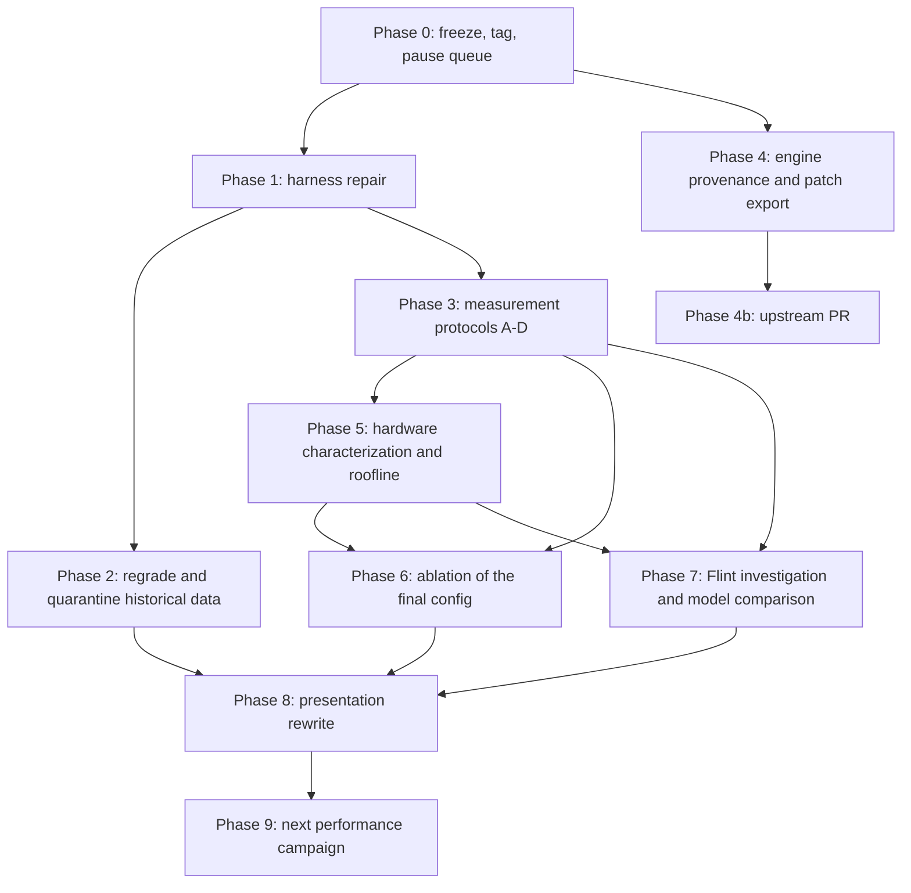

# Improvement plan: from lab notebook to credible showcase

Status: proposed. Written against repository snapshot `3c3526f` (2026-10-24, "Queue Exp 92 … Exp 93").

## 0. Purpose and scope

The engineering in this repo is strong: the MoE thread-partitioning patch in `iqk_mul_mat.cpp`, the `maddubs` sign trick, per-tensor quantization, NUMA placement, and a long speculation campaign. The weak point is **measurement**. The two headline claims ("nearly tripled throughput", "the new model performs much better") are not yet supported by artifacts that a researcher would accept, and several committed numbers come from broken tooling.

This plan has two jobs:

1. **Credibility.** Make every public number reproducible, correctly measured, and stated with its uncertainty.
2. **Showcase.** Turn the repo into something a recruiter can absorb in 60 seconds and a researcher can audit in 30 minutes.

It complements, and does not replace, [`performance-research.md`](performance-research.md). That document proposes the next *performance* experiments: NUMA chunking, corpus suffix, cost-aware drafting, and a socket-local backend. This plan builds the measurement and presentation foundation those experiments need. Section 13 (Phase 9) sequences them behind it.

### Non-goals

- New speed records before Phases 1–3 are complete.
- Hand-editing historical reports to "fix" numbers. Historical artifacts are quarantined and labelled, not rewritten.
- Hardware changes.

---

## 1. Findings that motivate this plan

Every row below was verified against the committed files.

### 1.1 Harness and catalog defects

| # | Defect | Evidence | Consequence |
| -: | --- | --- | --- |
| H1 | `correct` is never assigned in `run_experiment` | `benchmarks/gpqa_eval.py:404` writes `"correct": correct`; no assignment exists in the function (checked with `ast`) | The committed runner raises `NameError` on the first question. **The committed harness cannot have produced the committed results.** |
| H2 | Token ceiling is hard-coded | `query_completion(..., max_tokens=1536)` at `gpqa_eval.py:212`, called without `max_tokens` at `:380`; the report header hard-codes "1,536 tokens" at `:290` | Runs 71–91 claim a 4,096 ceiling, and their checkpoints show 4,096-token rows. The code that produced them is not in the repo. |
| H3 | Sampling is hard-coded | `temperature: 0.0, top_p: 1.0` at `gpqa_eval.py:216-217`; the catalog has no sampling field | Exp 83 ("T=0.3, top_p=0.95") cannot have run as described with this harness. |
| H4 | Steering prompts aren't representable | Catalog keys: `change,id,model,name,numactl,number,prep,prompt,server_flags,threads,threads_batch`; `prompt` ∈ {`stored`, `constructed`} | Exp 76/81/86 "concise reasoning steering (600 words)" has no catalog field to express it. |
| H5 | Chat template and system prompt are hard-coded ChatML | `chat_prompt` at `gpqa_eval.py:92-99` | Flint (runs 90–93) is sent Qwen's ChatML. Whether Flint uses ChatML is **[UNVERIFIED]**. A template mismatch would depress Flint's score. |
| H6 | The instructions contradict each other | System: "Always provide your final answer choice first." Stored prompt: "…finish with 'The correct answer is (X)'." | Format compliance becomes a confound across models. |
| H7 | Answer regex is permissive | `gpqa_eval.py:111-129` accepts `choice`/`option` followed by a letter, or any lone A–D on the last line | Hypotheses mentioned in passing can be scored as answers. |
| H8 | Resume doesn't guard identity | `load_checkpoint` plus the `completed` set at `:352`; no manifest check | A changed binary or flag set inherits old rows. Duplicates have entered checkpoints (H9). |
| H9 | Duplicate question rows | Checkpoints with `rows != unique ids`: exp46 (49 unique), exp69 (49), exp72 (46), exp77 (46), exp88 (46) | These runs score 50 rows over fewer than 50 distinct questions, so paired comparisons silently drop questions. |
| H10 | Duplicate catalog number | `experiments.json`: two entries with `"number": 90` (the `exp89_…` entry and `exp90_flint_…`) | `--exp 90` is ambiguous. |
| H11 | Needle benchmark uses the wrong binary | `benchmark_extreme_context.py:28-32` runs `llama-passkey`, not `llama-server` | Speculation flags passed to it don't exercise the server speculation path. "128K" prompts are ~192K tokens (see `performance-research.md` item 4). |
| H12 | No full outputs before run 66 | Checkpoints exp12–exp65 have `content` empty or missing in every row | Those runs **cannot be regraded**. Runs 66–91 can. |
| H13 | No engine provenance | No `patches/`, no ik_llama.cpp SHA per run, no GGUF hash, no build flags | The kernel work can't be reproduced or reviewed. |

### 1.2 Results-level problems

| # | Problem | Evidence |
| -: | --- | --- |
| R1 | GPQA mostly measures truncation | Run 88 (Qwen, 4K): 42/50 rows hit the ceiling, 30/50 have `pred = None`. Runs 15–60 at 1,536 tokens: 43–50 of 50 at the ceiling (`experiment-audit.md`). Chance on 4-way multiple choice is 25%. Baseline run 0 is 32%. |
| R2 | Sample size can't separate configurations | 95% Wilson intervals at n=50: 11/50 → 12.8–35.2%; 16/50 → 20.8–45.8%; 18/50 → 24.1–49.9%; 20/50 → 27.6–53.8%; 22/50 → 31.2–57.7%. |
| R3 | "Best accuracy, run 5, 22/50" was scored by the broken parser | Run 5 predates the strict parser (runs 66+) and has no saved content to regrade. |
| R4 | The 66.30 t/s peak is a degenerate loop | Runs 40/42 peaks: 1,536 tokens, `pred=None`, preview `<think> The.  .  .  .` (`experiment-audit.md`). |
| R5 | Accuracy changing under speculation should be impossible | Exact speculative decoding preserves the target's output (identical under greedy). Runs 72 and 88 differ only in MTP `p_min` and agree on every question (0 discordant pairs), so the setup is deterministic. So runs 40/42 changing answers and degenerating implicates either a verifier/rollback bug or batch-dependent numerics. |
| R6 | "Nearly tripled" conflates protocols | 7.96 → 24.53 t/s (×3.08) is the writeup's short bench with experts clamped 8→4, which is lossy. On the scored GPQA protocol: 11.16 (run 0) → 22.50 (run 46), ×2.02. |
| R7 | Flint vs Qwen isn't a clean comparison | On matched protocol (strict parser, 4K): Qwen run 88 got 11/50, Flint run 91 got 20/50. Over the 46 shared IDs, Flint-only correct = 10, Qwen-only = 3; exact McNemar p = 0.09. Flint hit the ceiling on 34/50 vs Qwen's 42/50, and took 4.77 h wall time vs 2.49 h. Flint is a coding model; GPQA is a science benchmark. |
| R8 | The 128K column mixes metrics | Runs 57–65 report ~38 t/s (prefill rate). Others report ~8 t/s (decode). |
| R9 | The writeup contradicts itself | §3: q4_0 KV "slower than q8_0". §4: plain q4_0 "even faster (+8.3%, 15.13 t/s)". The intro states a single-socket goal, but the shipped config interleaves both sockets. |
| R10 | Tone undermines trust | Run names like "Grand Unified Champion" and "Mega-Kernel"; RESULTS footnote "colossal all-time reasoning record 🏆🏆"; commit message "Flint Composite Champion Smashes All-Time GPQA Record". |

### 1.3 Queue risks (runs 92–93)

- **Exp 93** pairs Flint with a Qwen 3.5 0.8B draft model. Draft-model speculation needs a compatible vocabulary. Flint was trained from scratch by Recursive, so tokenizer compatibility with Qwen is **[UNVERIFIED]** and likely false. Verify before spending ~5 h of machine time.
- Both 92 and 93 would run on the defective harness.

**Decision: pause the queue (`logs/raw_checkpoints/pipeline_queue.json`) until Phase 1 is merged.**

---

## 2. Principles

1. **Speed and quality are measured separately.** Throughput comes from fixed-length generation on fixed prompts. Quality comes from evals that don't care how fast tokens arrive. GPQA rows are not a throughput benchmark.
2. **Lossless changes get an equivalence test, lossy changes get a divergence test, and only model or prompt changes get a task eval.**
   - Lossless: speculation, threading, NUMA placement, repack, alignment, kernel partitioning.
   - Lossy: weight quant, KV quant, expert count, SER.
3. **Every number carries its protocol.** A number without a protocol ID (Section 7, Phase 3) doesn't go in the README.
4. **Uncertainty is mandatory.** Throughput: median and IQR over at least 5 repetitions. Accuracy: Wilson 95% interval, plus a paired test for comparisons.
5. **Provenance per run.** Engine SHA plus dirty diff hash, build flags, GGUF sha256, dataset hash, template, request parameters, CPU topology. A resume with a mismatched manifest is refused.
6. **Historical data is quarantined, not deleted.** It moves to `archive/` with a README explaining what is and isn't valid.

---

## 3. Phase map



Phases 1 and 4 can run in parallel: one is harness code, the other is engine code. Phase 8 can start drafting early, but nothing is published until its inputs are final.

---

## 4. Phase 0: freeze and triage

| Task | Detail |
| --- | --- |
| 0.1 Tag the current state | `git tag notebook-v1 3c3526f`. All historical claims remain reachable at this tag. |
| 0.2 Pause the pipeline | Empty or rename `pipeline_queue.json`, stop the watchdog unit, and note the pause in the lab notebook. |
| 0.3 Verify the Exp 93 tokenizer | Compare `tokenizer.ggml.model`, vocab size, and the first 1,000 token strings of `RecursiveSI_flint-Q4_0.gguf` against `Qwen3.5-0.8B-Q4_K_M.gguf` (`gguf-dump` or `gguf` Python). Drop Exp 93 if they differ. |
| 0.4 Find the real runner | Locate the harness version on the T630 that produced runs 66–91 (it writes `reasoning_completed` and accepts a 4,096 ceiling). Commit it verbatim as `archive/harness/gpqa_eval_runs66-91.py` so history is honest about what produced what. |

**Exit criteria:** the tag exists, the queue is stopped, the Exp 93 decision is recorded, and the actual historical runner is committed (or documented as lost).

---

## 5. Phase 1: harness repair

Goal: one runner that can reproduce any catalogued run from the catalog alone, saves everything needed to regrade offline, and refuses to mix incompatible results.

### 1.1 Catalog schema (`benchmarks/experiments.json`)

Add explicit fields and validate them on load. Any run's request must be fully determined by its catalog entry.

```jsonc
{
  "number": 94,                      // unique; validated
  "id": "exp94_...",                 // unique; validated
  "name": "Qwen IQ4_XS/Q4_0 + suffix(8,5) + MTP",   // plain, descriptive (see 8.3)
  "model": "Qwen3.6-35B-A3B-UD-IQ4_XS_MoE_Q4_0_Repacked.gguf",
  "model_sha256": "…",               // new; checked before launch
  "engine": {"repo": "ik_llama.cpp", "sha": "…", "patches": ["patches/0001-…"]},  // new
  "numactl": "…",
  "server_flags": "…",
  "request": {                       // new; replaces hard-coded values
    "endpoint": "chat",              // "chat" = /v1/chat/completions with the model's own template
    "max_tokens": 4096,
    "temperature": 0.0,
    "top_p": 1.0,
    "seed": 0,
    "system_prompt": null,           // null = none
    "user_suffix": "standard_v2"     // key into benchmarks/prompts/*.txt
  },
  "protocol": "C-gpqa-v2",           // protocol ID from Phase 3
  "lossy": false,                    // drives which quality gate applies
  "change": "…"
}
```

Tasks:

- Write `benchmarks/catalog.py` with `load_catalog()` that validates unique `number`/`id`, required keys, and known `protocol`/`user_suffix` values. Fix the duplicate `number: 90` (H10) by renumbering the exp89 entry to 89.
- Move prompt suffixes into `benchmarks/prompts/` as versioned text files. Hash them into the manifest.

### 1.2 Request path (`gpqa_eval.py`)

- **Use the server's chat endpoint** (`/v1/chat/completions`) so each model's embedded GGUF chat template is applied (fixes H5). Keep raw `/completion` only behind an explicit `endpoint: "raw"` with a template file.
- **One consistent instruction:** reason freely, then end with exactly `Final answer: X`. No "answer first" system prompt (H6).
- Pass `max_tokens`, sampling, and seed from the catalog (H2, H3).
- **Save per row:** full `content`, `reasoning_content` if the server separates it, `finish_reason`/`stop_type`, `tokens_predicted`, `tokens_evaluated`, all `timings` fields, speculative stats if the server reports them (`draft_n`, `draft_n_accepted`), wall time, request JSON hash.

### 1.3 Grading (`benchmarks/grading.py`, new)

- **Strict extractor:** take only text outside the reasoning block. Require the last match of `^\s*Final answer:\s*\(?([A-D])\)?\s*$` (multiline). Otherwise `None`.
- **Lenient extractor:** today's patterns, kept only to *report* how many answers depend on leniency. It never decides the headline score.
- **Row status enum:** `correct`, `wrong`, `no_answer_truncated` (finish = length), `no_answer_format` (finished but no parseable answer), `error`.
- **Unit tests** in `benchmarks/tests/test_grading.py`: the audit's adversarial cases (unclosed think containing "option B"; "choice" mid-sentence; a lone letter in prose; boxed answers; trailing whitespace). This is the plausible-bug class that already bit the project, so it deserves permanent tests.

### 1.4 Run manifest and resume guard

- `benchmarks/manifest.py` collects: engine SHA plus `git diff` hash of the engine checkout, `cmake` cache flags, compiler version, GGUF sha256, `gpqa_subset` sha256, prompt-file hashes, the request block, `lscpu`/`numactl -H` digest, kernel version, and THP setting.
- Write it as `logs/runs/<id>/manifest.json` at start. On resume, compare it field by field and **refuse** to continue on mismatch unless `--force-new-run`, which writes a new run directory.
- Key rows by question ID. Writing a duplicate ID is an assertion error (H8, H9).

### 1.5 Output layout

Replace the flat files with one directory per run:

```
logs/runs/<id>/
  manifest.json
  rows.jsonl          # one row per question, append-only
  server.log          # copied from /tmp at end
  summary.json        # machine-readable aggregate (Section 7 protocol metrics)
  report.md           # generated from summary.json; never hand-edited
```

Generate `RESULTS.md` from `summary.json` files with `benchmarks/build_results.py`, not by hand.

### 1.6 Needle benchmark (`benchmark_extreme_context.py`)

- Run through `llama-server` with the same flags as the experiment, so speculation is actually exercised (H11).
- Build the haystack by **token count** using the server's `/tokenize` endpoint. Label contexts by measured prompt tokens (e.g. "131,072 tokens"), not by `-c`.
- Pass only if the passkey appears in the *generated* text (not prompt or logs), the request succeeded, and the server process is still healthy.
- Record prefill t/s, decode t/s over a fixed 256-token generation, TTFT, and peak RSS as separate fields. A single "speed" field is not allowed (R8).
- Several needle depths per context (10/50/90%), so "passed" means more than one lucky position.

### 1.7 Watchdog

`master_watchdog_pipeline.py` launches `gpqa_eval.py --exp N` through `systemd-run`. After 1.1, have it reject catalog entries that fail validation, and stop the queue on the first `error` row instead of continuing.

**Phase 1 exit criteria**

- [ ] `python benchmarks/gpqa_eval.py --exp <new control> --dry-run` prints the full resolved request and manifest.
- [ ] `pytest benchmarks/tests` passes (grading and catalog validation).
- [ ] One full control run (Qwen run-50 config under protocol C-gpqa-v2) completes, with `rows.jsonl` containing full content and finish reasons, and 50 unique IDs.
- [ ] Re-running the same command resumes. Changing one flag refuses to resume.

---

## 6. Phase 2: regrade and quarantine historical data

| Task | Detail |
| --- | --- |
| 2.1 Regrade runs 66–91 offline | They have full `content` (H12). Run `grading.py` strict and lenient over each checkpoint. Deduplicate by ID (keep the first occurrence) and **report** the count of dropped duplicates per run. Output `archive/regraded/<run>.json`. |
| 2.2 Quarantine runs 0–65 | No content means no regrade. Their GPQA scores move to an archive table labelled "scored by the pre-fix lenient parser; not comparable." Their *throughput* numbers stay, labelled "mean of per-request decode rates on variable-length outputs; not a controlled throughput measurement." |
| 2.3 Mark degenerate outputs | Flag rows whose content has repetition ratio above a threshold (e.g. any 8-gram repeated more than 20 times, or more than 50% punctuation). Exclude flagged rows from any "useful throughput" figure. Runs 40/42 peaks are the canonical example (R4). |
| 2.4 Fix the 128K column | Split into `needle_passed`, `prefill_tps`, `decode_tps`. Leave cells empty where the snippet doesn't contain the metric (runs 57–65 decode). Don't backfill guesses. |
| 2.5 Archive layout | Move `logs/gpqa_reports/`, `logs/extreme_context_reports/`, `logs/raw_checkpoints/` and `logs/optimization_tracker/` under `archive/notebook-v1/`, with an `archive/README.md` summarizing validity per artifact class (the tables in Section 1). |

**Exit criteria:** `archive/README.md` exists. Regraded tables for runs 66–91 exist with duplicate counts. No live document cites a quarantined score without its label.

---

## 7. Phase 3: measurement protocols

Four protocols, each with an ID, a script, and fixed reporting. Every future number cites one.

### Protocol A: throughput (`A-tput-v1`) — `benchmarks/bench_throughput.py`

Purpose: measure decode, prefill, and end-to-end speed independent of answer quality.

- **Prompt set:** 12 fixed prompts across three workload classes. Commit them in `benchmarks/prompts/tput/`.
  1. Code edit: a real file plus an instruction.
  2. Fresh code generation.
  3. Prose/reasoning.

  Speculation gains depend heavily on workload, and code repetition is what makes suffix/n-gram work, so results are reported per class.
- **Fixed output length:** `n_predict = 512` with `ignore_eos: true`, so every configuration produces the same number of tokens. Exception: speculation is reported with natural stopping too, because forced continuation past EOS changes acceptance behaviour. Both are labelled.
- **Context points:** 2K, 8K, 32K prompt tokens (measured), plus 128K as a separate slow tier.
- **Repetitions:** 5 per (config × prompt). Randomize configuration order across repetitions to spread thermal and page-cache drift. One discarded warm-up per server start.
- **Metrics:** decode t/s = `tokens_predicted / predicted_ms`; prefill t/s; TTFT; end-to-end wall; speculation acceptance rate and mean accepted length; peak RSS. Report median and IQR. The headline aggregate is token-weighted (`sum tokens / sum time`), never a mean of rates.
- **"Useful throughput":** tokens/s over non-degenerate outputs only (2.3 filter). This is the only speed number that can be called a "peak."

### Protocol B: speculation equivalence (`B-equiv-v1`) — `benchmarks/check_equivalence.py`

Purpose: prove lossless optimizations are lossless, and turn the runs 40/42 anomaly into a bug report.

- Greedy decoding, fixed seed, same GGUF, same KV type, same routing flags. Compare token IDs (`n_probs` / `return_tokens`) of the config under test against the no-speculation reference.
- **Report per prompt:** identical (yes/no), index of first divergent token, and the reference top-2 logit margin at that position.
- **Classify:**
  - Divergence at a near-tie (margin < ~0.05 nats): batch-size-dependent float reduction order. Expected and acceptable; document it.
  - Divergence at a large margin: **bug** in verification, KV/recurrent-state rollback, or batched kernels. Qwen3.6 has 30 Gated DeltaNet (linear-attention) layers whose recurrent state must be checkpointed and restored on rejection. That's the prime suspect for suffix drafts with `n_max` ≥ 12.
- **Investigation for R5:** reproduce run 42's `gpqa_128` degeneration with suffix `n_max=16` vs no speculation. Bisect on `n_max`, KV type (q4_0 vs f16), and `-ser`. Capture the first divergent token. If it's a rollback bug, write a minimal repro and file it upstream. That issue (or fix) is a better portfolio artifact than the 66 t/s number.
- **Gate:** any config marked `lossy: false` must pass B (identical, or near-tie divergence only) before its throughput is published.

### Protocol Q: divergence for lossy changes (`Q-kld-v1`) — `benchmarks/kld.sh`

Purpose: low-noise, cheap quality measurement for quant, KV-quant, expert-count, and SER changes. This replaces GPQA as the gate for those changes.

- Reference: BF16 or Q8_0 of the same model, computed once with `llama-perplexity --kl-divergence-base ref.kld` on a fixed corpus: ~100K tokens of code (from repos *not* in any eval) plus ~50K tokens of wikitext-2 test.
- Candidate: `llama-perplexity --kl-divergence-base ref.kld --kl-divergence` with the candidate model and flags.
- **Report:** mean KLD, 99th-percentile KLD, top-1 token agreement %, Δ perplexity. One row per lossy change in a single table:

  | Change | Mean KLD | p99 KLD | Top-1 agree | ΔPPL |
  | --- | ---: | ---: | ---: | ---: |
  | Q6_K → IQ4_XS attention + Q4_0 experts | | | | |
  | KV f16 → q8_0+Hadamard | | | | |
  | KV f16 → q4_0 | | | | |
  | Experts 8 → 4 | | | | |
  | SER 2,0.5 | | | | |

- If `--kl-divergence` can't take server-only flags (e.g. SER behaviour differs between binaries), verify the flag's effect in `llama-perplexity` by counting executed experts, or note the gap.
- Flint gets its own reference and table.

### Protocol C: task evals (`C-code-v1`, `C-gpqa-v2`)

Purpose: answer "is the model good at the job?" Used only for model or prompt changes, and for the final configuration of each model.

**C-code-v1 (primary, matches the stated use case: long-context coding assistant):**

- EvalPlus **HumanEval+** (164 problems) and/or **MBPP+**, executed in a sandbox, pass@1 greedy. Optionally a 50–100 problem LiveCodeBench slice published after both models' release dates, to limit contamination.
- A small **held-out personal suite**: 20–30 real edit/debug tasks from your own repos, each with an executable test. This is the most persuasive artifact for "daily coding assistant."
- Thinking budget fixed and recorded. Report pass rate and also **wall-clock per solved task**.

**C-gpqa-v2 (secondary reasoning check):**

- Full **GPQA Diamond (198 questions)**, not a 50-question subset. Even at 198, the minimum detectable unpaired difference at 80% power is ~13 percentage points (p≈0.35). Paired analysis on identical questions narrows it.
- Budget: report results at several thinking budgets (1K, 4K, 8K, and "until done" where affordable). Machine-time cost at 4,096 tokens per question is ~10.7 h for Qwen at ~21 t/s and ~22.5 h for Flint at ~10 t/s, so schedule overnight runs and budget them deliberately.
- Report the truncation rate alongside accuracy for every budget.

**Statistics for every C comparison:**

- Wilson 95% interval per score.
- Paired comparison on identical IDs: exact McNemar p-value plus the discordant counts (b, c).
- Declare primary comparisons in advance in `docs/eval-protocol.md`, and stop using "record" language.
- If multiple configs are compared against one control, apply Holm correction.

### Accuracy vs. time budget (the "pace of open models" figure)

The truncation problem becomes the experiment. For each model's best lossless configuration, run C-code (and C-gpqa if affordable) under a sequence of **wall-clock** budgets, e.g. 30 s, 60 s, 120 s, 300 s, 600 s per problem. Generation stops at the budget and is scored strict. Plot accuracy vs. budget for Qwen3.6-35B-A3B and Flint-40B-A2.5B on the same axes. This is the honest, useful version of "a newer model at similar speed does better": it shows exactly where, at which budget, and by how much on this hardware.

**Phase 3 exit criteria**

- [ ] `docs/eval-protocol.md` defines A, B, Q, C with exact parameters and versioned prompt sets.
- [ ] Each protocol has a script that writes `summary.json` in a shared schema.
- [ ] The run-0 baseline config and the run-50 config are re-measured under A, B, and Q. These become the new reference numbers.
- [ ] The R5 investigation has a written conclusion: near-tie numerics, or a bug with a repro.

---

## 8. Phase 4: engine provenance, patch export, upstream

The kernel work is the most impressive part of the project and is currently invisible (H13).

| Task | Detail |
| --- | --- |
| 4.1 Fork and branch | Fork `ikawrakow/ik_llama.cpp` on GitHub. Rebase the local modifications onto a pinned upstream SHA as **separate, self-describing commits**: (a) MoE small-`Nx` K-split partitioning in `iqk_mul_mat.cpp`; (b) 64-byte alignment of scratch buffers and row strides; (c) any SER/threshold changes (`performance-research.md` notes upstream SER threshold selection is commented out, so document what your build actually does); (d) the operator timing instrumentation, behind a compile flag. |
| 4.2 Export patches | `git format-patch <upstream-sha>..HEAD -o patches/` into this repo, plus `patches/README.md` with one paragraph per patch: what it changes, why, and its measured effect under Protocol A. |
| 4.3 Build script | `scripts/build_engine.sh`: clone the fork at a pinned SHA (or apply `patches/` onto upstream), configure with explicit CMake flags (record `GGML_EXPERT_CHUNKING`, AVX2/FMA/F16C, OpenMP), and build. It prints the SHA and flags for the manifest. |
| 4.4 Correctness test for the K-split | Standalone test: random Q4_0/IQ4_XS weights and Q8 activations, shapes `Nx ∈ {1,2,3,4,6,8}` × `nth ∈ {1,7,14,28}` × `K ∈ {2048, 4096, 5120}`. Compare the patched kernel against the unpatched kernel and a scalar reference. Assert max abs error within accumulation-order tolerance. Run under `-fsanitize=address,undefined` once. |
| 4.5 Kernel microbenchmark | Time the patched vs unpatched MoE matmul for those shapes, single socket and interleaved. Report GB/s achieved (bytes of weights read / time) next to the Phase 5 STREAM number. This is the evidence that "100% utilization" turned into bandwidth, or that it didn't, which is equally interesting. |
| 4.6 Re-verify the profile | The current operator breakdown (52% + 39% + 21%, overlapping) can't support quantitative claims. Re-profile with per-thread timers summed correctly, or with `perf record`/`perf stat` and Intel PCM. Report shares that add to 100% of measured decode time. |
| 4.7 Upstream PR | Open a PR (or a Discussion first, if the maintainer prefers) for the K-split patch, with the 4.4 test and 4.5 numbers. Link it from the README whatever the outcome. A reviewed external PR is the single strongest signal for both audiences. |

**Exit criteria:** `patches/` and `scripts/build_engine.sh` reproduce the engine. The kernel test passes. Microbench numbers exist. The PR or discussion link exists.

---

## 9. Phase 5: hardware characterization and roofline

Goal: state what fraction of the physical ceiling the system achieves, and where the gap goes.

| Task | Detail |
| --- | --- |
| 5.1 Platform record | Commit `docs/hardware.md`: `lscpu`, `numactl -H`, DIMM population (`dmidecode -t memory`, redacted), BIOS settings (snoop mode, COD/NUMA, turbo, C-states, power profile), kernel version, THP, governor. |
| 5.2 Measured bandwidth | STREAM (triad, ≥4× LLC per array) and/or Intel MLC: local socket-0 read bandwidth, local both sockets, remote (socket 0 reading node 1), and `--interleave=all`. This replaces the theoretical 76.8 GB/s in every calculation. |
| 5.3 Bytes per token model | `benchmarks/bytes_per_token.py` reads GGUF tensor shapes and types (`gguf` Python package) and computes bytes touched per decoded token = dense tensors (attention, shared experts, norms, output head) + `k` × per-expert bytes × MoE layers + KV/recurrent state at context L. Parameterized by `k` (experts used) and context length. Cross-check against PCM-measured DRAM reads per token. |
| 5.4 Roofline | For each reference config: ceiling t/s = measured bandwidth ÷ bytes/token. Plot achieved decode t/s (Protocol A, no speculation) vs ceiling at 2K/8K/32K for both models. With speculation, plot *effective* tokens per weight pass. |
| 5.5 Gap accounting | From 4.6 profiling: split decode time into weight streaming, dequant compute, attention/recurrent, synchronization/barriers, and other. For dual socket, add QPI traffic and remote-read share (PCM). This is where `performance-research.md`'s NUMA hypotheses get tested. |

**[INFERENCE]**, to be replaced by 5.3/5.4 numbers: Qwen's ~3B active params at ~4.5 bits is ~1.7 GB/token. At 76.8 GB/s theoretical single-socket bandwidth that's a ceiling of ~45 t/s, so ~21 t/s with speculation is roughly 25–45% of the limit. Don't publish this estimate. Publish the measured version.

**Exit criteria:** `docs/hardware.md` and a roofline figure generated from committed data exist, and the gap-accounting table sums to measured time.

---

## 10. Phase 6: ablation of the final configuration

Goal: replace the 91-row table with one figure showing what each optimization contributes.

- **Configs:** the final lossless config and the final lossy config, each as the "full" config.
- **Leave-one-out:** remove one component at a time, keeping everything else fixed. Components: NUMA interleave/pinning; 28 physical threads vs 14; repack; `-muge`; `--defer-experts`; MTP; suffix speculation; KV quant; weight quant recipe; SER; patched kernel (needs a build without the K-split patch, from Phase 4).
- **Also forward-add,** in historical order from the run-0 baseline. The waterfall chart uses this ordering because it tells the story. The leave-one-out table shows interactions.
- **Measurement:** Protocol A for speed. Protocol B pass/fail for lossless components. Protocol Q row for lossy components.
- **Output:** `docs/figures/waterfall.svg` and `docs/ablation.md`, generated by `scripts/make_figures.py` from `summary.json` files.

**Exit criteria:** every component has a median Δ t/s with IQR under Protocol A, and every lossy component has a Q row.

---

## 11. Phase 7: Flint investigation and model comparison

### 7.1 Make the Flint setup fair

- Verify Flint's chat template and recommended sampling and thinking settings from the model card. Use the chat endpoint (Phase 1.2).
- Re-check what `-fa auto` resolves to and whether Flint's tensors use the same AVX2 fast paths. Run `llama-quantize` with a custom recipe analogous to Qwen's (IQ4_XS dense + Q4_0 experts) and repack offline. The current Flint runs use plain Q4_0 with no repack, against a heavily tuned Qwen.
- Does Flint ship an MTP head? If yes, enable it; if no, note it.

### 7.2 Explain why Flint is slower

Observed: Flint 9.97 t/s (run 90, no speculation) vs Qwen 11.16 t/s (run 0, no speculation, single socket), despite fewer active parameters (2.5B vs ~3B). Catalog notes describe Flint as 256 routed experts, 6 selected + 1 shared, 49 layers.

Hypotheses to test, each with a measurement:

| Hypothesis | Measurement |
| --- | --- |
| Many small experts make small GEMVs inefficient (per-call overhead, poor prefetch, scattered rows) | Kernel microbench at Flint's expert shape vs Qwen's. Achieved GB/s per MoE call. |
| More layers (49 vs 40) means more barriers per token | Profile synchronization share (Phase 5.5). Count barriers per token. |
| Q4_0 on dense tensors and no repack | Q-recipe and repack A/B under Protocol A. |
| Thread partitioning: with `Nx`=6–7 experts and 28 threads, the small-`Nx` path may or may not trigger | Log the path taken. Sweep threads 14/20/28. |
| Real bytes/token differs from "1.50 GB/token" in the catalog | Phase 5.3 model plus PCM DRAM reads. |

The result is a short write-up, "Why a smaller-active model ran slower on Broadwell," which ties straight back to the original kernel insight.

### 7.3 Model comparison

- Both models at their best lossless config (Protocol B verified) and their best lossy config (Protocol Q characterized).
- C-code-v1 and the accuracy-vs-time-budget curves (Phase 3) on identical problems, with paired statistics.
- Optionally C-gpqa-v2 on full Diamond at matched budgets.
- **Headline sentence template:** "On this 2016 Xeon, at a 120-second-per-task budget, Flint-40B-A2.5B solves X% [CI] of HumanEval+ vs Y% [CI] for Qwen3.6-35B-A3B (paired McNemar p=…), despite decoding at A vs B t/s." The claim is whatever the data says, including "no detectable difference."

**Exit criteria:** fair Flint config documented, the slowdown explained with measurements, and comparison figures generated.

---

## 12. Phase 8: presentation

### 8.1 Claims register

Every current public claim, with its replacement. This governs the README, writeup, Substack correction, and resume line.

| Current claim | Where | Status | Replace with |
| --- | --- | --- | --- |
| "Nearly tripled" / 7.96 → 24.53 t/s | Writeup TL;DR, Substack, README | Mixed protocols; lossy expert clamp | Two numbers: "×N lossless (Protocol A)" and "×M with expert pruning, at KLD = …" |
| "Highest peak 66.30 t/s" | README Results | Degenerate output (R4) | Remove. Optionally: "Suffix speculation reached 66 t/s on a degenerate repetition loop; see the bug investigation." |
| "Best accuracy run 5, 22/50" | README Results | Broken parser, n=50 (R2, R3) | Remove. Archive only. |
| "Every needle ladder that reached 128K passed" | README | Wrong binary, ~192K tokens, single depth (H11) | Phase 1.6 results with measured token counts and depths. |
| "Utilization 28% → 100%" | README, writeup §5 | Plausible; no artifact | Keep, with the Phase 4.5 microbench and achieved GB/s. |
| "+6.75% from repack, no extra RAM" | README, writeup §3 | Single early sweep | Protocol A median and IQR from the Phase 6 ablation. |
| "Colossal all-time reasoning record 20/50" | RESULTS footnote, commit message | n=50, p=0.09 vs matched Qwen | Remove. Replace with Phase 7.3 comparison. |
| q4_0 KV "slower" (§3) vs "faster" (§4) | Writeup | Contradiction (R9) | Single Protocol A + Q result. |
| "Goal: one socket" vs shipped dual-socket config | Writeup intro, README hardware table | Inconsistent | State both configurations explicitly. |

### 8.2 README rewrite (one screen above the fold)

Structure:

1. **Title and one-sentence description.** E.g. "Serving 35B-class MoE coding models on a 2016 dual-Xeon (AVX2-only) server: kernel patches, quantization, NUMA, and speculative decoding, with a measured roofline." Keep the "we have Claude Code at home" joke as a subtitle if you like it; it can't be the only description.
2. **Hero figure:** the ablation waterfall (Phase 6), baseline → final, lossless and lossy marked.
3. **Three headline numbers,** each with protocol and uncertainty: lossless speedup; % of measured bandwidth ceiling; model-comparison sentence (Phase 7.3).
4. **"The interesting engineering"** in three short subsections, each linking to an artifact: the K-split kernel patch (diff, test, microbench, upstream PR); the quantization recipe (KLD table); the speculation equivalence finding (Protocol B result / bug report).
5. **What didn't work:** THP, SMT for decode, external 0.8B drafter (memory contention, segfault postmortem), deep suffix drafts. Negative results show judgment.
6. **Reproduce:** `scripts/build_engine.sh` → `bench_throughput.py --config final` → expected output range.
7. **Links:** writeup, eval protocol, hardware record, archive.

Things to remove from the README: per-run numbers from quarantined runs, peak t/s, emoji, superlatives.

### 8.3 Naming cleanup

- Rename catalog `name` fields to plain descriptions of the delta, e.g. "Exp 23: Grand Unified Champion (…)" becomes "Exp 23: chained spec (ngram hits=2 + MTP) + q4_0 KV + SER 2,0.5". Keep `id` unchanged so artifact paths stay stable.
- Drop "Mega-Kernel" unless it names a specific committed patch. If it does, call it by what it does ("prefetching MoE kernel").
- Rewrite `change` fields as hypothesis plus single variable, no adjectives ("zero-overhead", "colossal", "eliminating").
- Going forward, commit messages say what was added, not how good it was ("Add run 91 checkpoint and report").

### 8.4 RESULTS.md

- Generated by `build_results.py`.
- **Current:** only protocol-v2 runs, with CIs and protocol IDs.
- **Archive:** link to `archive/README.md` and the regraded 66–91 table.

### 8.5 Figures (all generated from committed data by `scripts/make_figures.py`)

1. Ablation waterfall (Phase 6).
2. Roofline: achieved vs ceiling by context length, both models (Phase 5.4).
3. Accuracy vs wall-clock budget, both models (Phase 3/7.3).
4. Speculation: acceptance length vs draft depth, with useful throughput (Protocol A per workload class).
5. Optional: the K-split thread-utilization diagram, before/after.

### 8.6 Writeup and Substack

- Update `docs/writeup.md` to the claims register (8.1): fix the R9 contradictions, replace the TL;DR numbers, add sections on the measurement repair and the speculation equivalence investigation. A "how I found my benchmark was lying to me" section is a strength for a researcher audience.
- Publish a short follow-up or correction note on Substack linking to the new results, rather than silently editing the original.

### 8.7 Showcase page and resume line

- **Showcase page** (GitHub Pages from `docs/`, or a personal site): hero waterfall, three numbers, roofline, accuracy-vs-time plot, links to PR, patches, and writeup. No tables longer than 10 rows.
- **Resume line template:** "Doubled lossless decode throughput (11 → 22 t/s, n=5 runs) of a 35B MoE LLM on a 2016 AVX2 dual-Xeon by patching ik_llama.cpp's MoE matmul thread partitioning [upstream PR], mixed-precision quantization (KLD-verified), and NUMA-aware speculative decoding; reached X% of measured DRAM bandwidth roofline." Fill in the numbers only after Phases 3–6.
- **GitHub repo metadata:** description, topics (`llm-inference`, `llama-cpp`, `cpu-inference`, `moe`, `speculative-decoding`, `quantization`, `numa`), and a social-preview image of the waterfall.

**Exit criteria:** every README number appears in the claims register with a protocol, no quarantined number appears outside `archive/`, and figures regenerate from a clean checkout.

---

## 13. Phase 9: next performance campaign

Only after Phases 1–3 are done, using Protocols A/B/Q/C and the promotion rules already proposed in [`performance-research.md`](performance-research.md) ("A bounded next campaign"):

1. `GGML_EXPERT_CHUNKING` ON/OFF × interleave/first-touch placement, with PCM counters.
2. Stable-prefix multi-turn cache reuse (TTFT and task completion time, verifying recurrent state).
3. MTP vs suffix+MTP vs corpus-suffix+MTP on held-out coding tasks.
4. Expert-only quantization microbench, then end-to-end with a Q gate.
5. Cost-aware draft-length controller (unique experts touched per verification batch).
6. Socket-local layer prototype, if Phase 5.5 gap accounting justifies it.

Each experiment is added to the catalog with `protocol` and `lossy` set, and promoted only by the predeclared rule.

---

## 14. Risks and mitigations

| Risk | Mitigation |
| --- | --- |
| The historical runner (Phase 0.4) is lost | Document it as lost in `archive/README.md`. Runs 66–91 are still regradable from content, but their request parameters (ceiling, sampling) can only be inferred from token counts. Say so. |
| Machine time: full Diamond is ~11 h (Qwen) / ~22 h (Flint) per config at a 4K budget | Use Protocol Q for lossy changes and Protocol B for lossless ones; reserve C for final configs. Schedule C overnight via the watchdog. Prefer coding evals with shorter outputs. |
| Protocol B shows large-margin divergence (a real bug) | Treat it as the highlight, not a setback: minimal repro, upstream issue, and a writeup section. Until fixed, publish speculation throughput only for configs that pass. |
| Re-measured numbers come in lower than the published ones | Expected for peak/mean-of-rate artifacts. Publish the lower, defensible numbers with a short changelog of why. Credibility is the goal. |
| KLD tooling doesn't support a server-only flag (SER, `-muge`) | Verify flag effect by counting executed experts. Otherwise fall back to Protocol B-style token-agreement measurement against the reference through the server. |
| Upstream rejects or ignores the PR | Still link it. A reviewed and declined PR with discussion is still evidence. |

---

## 15. Definition of done

- [ ] Queue paused. `notebook-v1` tag exists.
- [ ] Harness: catalog schema validated; chat-template endpoint; strict grader with tests; manifests; resume guard; no duplicate IDs possible; needle via server with measured token counts.
- [ ] Historical data: runs 66–91 regraded with duplicate counts; runs 0–65 quarantined with labels; degenerate rows flagged.
- [ ] Protocols A, B, Q, C documented in `docs/eval-protocol.md` with scripts and a shared `summary.json` schema.
- [ ] Runs 40/42 anomaly explained (numerics or bug with repro).
- [ ] Engine: patches exported, build script, kernel correctness test, microbench, upstream PR/discussion linked.
- [ ] Hardware record, measured bandwidth, bytes/token model, roofline, gap accounting.
- [ ] Ablation waterfall and leave-one-out table.
- [ ] Fair Flint config, slowdown explanation, paired model comparison with accuracy-vs-time curves.
- [ ] README, RESULTS, writeup and Substack follow-up aligned with the claims register. Naming cleaned. Figures regenerate from data.
- [ ] Resume line and showcase page filled from final numbers only.
